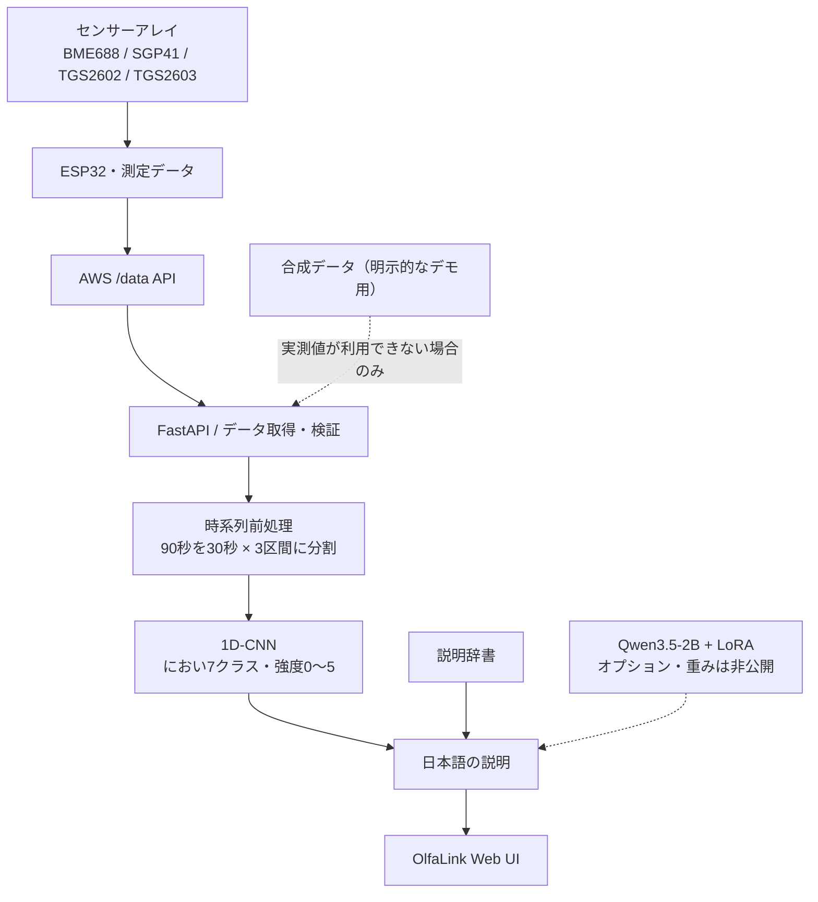

OlfaLink
においを、データから人に伝わる情報へ。

OlfaLinkは、複数のガスセンサーから得られる時系列データを解析し、生活環境のにおいの種類や強度を可視化することを目指す研究開発中のプロトタイプです。

現在は、ESP32につながるセンサー群の測定値をWebアプリから取得し、1D-CNNでにおいの分類と強度推定を行います。推定結果は日本語の説明として表示でき、オプションでLLMを利用できます。
Research prototype / 実験段階
においの識別精度・未知環境への汎化性能は確立していません。現時点で、化学物質の同定、ガス濃度測定、健康・安全判断には利用できません。

目指していること
人間には分かる「生ごみのようなにおい」「刺激的なにおい」といった感覚的な情報を、センサーが出力する数値から説明できるようにすることです。

現在の実装は、既知の7クラスの分類に限定した初期検証です。将来的にはセンサーの測定品質や選択性の改善、混合臭・未知臭への対応、知覚特徴に基づく表現を研究課題としています。これらは実装済み機能ではありません。
システム構成

- オンデマンド解析：Web画面で解析ボタンを押したときにデータを取得し、推論を実行します。常時LLM推論はしません。
- センサーデータ：BME688のガス抵抗・温湿度、SGP41のVOC/NOx指標、TGS2602/2603のADC値を使用します。
- 種類・強度の推定：実験用1D-CNNが7つの既知クラスと0〜5の強度を出力します。
- 日本語説明：既定は説明辞書。設定されたLLMサービスが利用できる場合は、分類結果をもとに説明を生成します。LLMが生のセンサー波形を理解する仕組みではありません。
- データの出所を明示：実測値 device と合成デモ synthetic_demo を区別します。
技術スタック
レイヤー	主な技術
センサー・組込み	ESP32、BME688、SGP41、TGS2602、TGS2603
データ連携	AWS API Gatewayの読み取りAPI（/data）
バックエンド	Python、FastAPI、Pydantic、httpx
機械学習	PyTorch、1D-CNN、NumPy
言語生成（任意）	Qwen3.5-2B、LoRA、Transformers、PEFT
フロントエンド	HTML、CSS、JavaScript
デプロイ先（任意）	Google Cloud Run

ローカルで試す
Google CloudやGPUの契約は不要です。 AWSの読み取りキーがなくても、合成データを用いた画面・推論の動作確認ができます。合成データの結果にはその旨が表示されます。
Windows（推奨の起動方法）
1. 64bit版の Python 3.11 または 3.12 を用意します。
2. このリポジトリをクローン、またはZIPで取得します。
3. olfalink-webapp/Launch_Local.bat を実行します。初回のみ依存ライブラリのインストールにネット接続が必要です。
4. http://127.0.0.1:8765 を開き、「においを解析する」を選びます。
git clone https://github.com/mathkumamoto2/OlfaLink.git
cd OlfaLink\olfalink-webapp
.\Launch_Local.bat
実行中はターミナルを閉じず、終了時は Ctrl+C を使用してください。
コマンドラインで起動する場合
cd olfalink-webapp
python -m venv .venv
# Windows PowerShell: .venv\Scripts\Activate.ps1
# macOS/Linux: source .venv/bin/activate
python -m pip install -r requirements-local.txt
python -m pip install 'torch>=2.4,<3'
python run_local.py
PyTorchのCPU版を使用したい場合は、環境に合うインストール方法をPyTorch公式サイトで確認してください。Windows用起動スクリプトはCPU版PyTorchを導入します。
実測データを接続する場合
olfalink-webapp/config.env.example を config.env にコピーし、利用者自身が管理するAWS読み取りキーを設定します。`config.env` はGitの除外対象です。認証情報はコード、Issue、ログに記載しないでください。
OLFALINK_READ_KEY=your-read-only-key
OLFALINK_FORCE_DEMO=false
利用には対象のAWS API・センサーデータへのアクセス権限が必要です。無効なデータや必要なセンサー値の欠損時には、ローカル版は合成デモに切り替わるため、推論結果が実測値に基づくかを必ず確認してください。
API（主なエンドポイント）
WebアプリのAPI仕様は起動後、`http://127.0.0.1:8765/api/docs` から確認できます。
メソッド・パス	用途
POST /api/v1/inference/on-demand	ボタン操作によるデータ取得・CNN推論・説明生成
GET /api/v1/dashboard	保存された直近の推論結果を取得（再推論しない）
GET /api/v1/healthz	アプリケーションの起動確認
GET /api/v1/integration/status	連携設定・動作モードの確認

リポジトリ構成
OlfaLink/
├── README.md
├── olfalink-webapp/
│   ├── app/              # FastAPI・AWSデータ取得・推論処理
│   ├── ml/               # CNNモデル定義・時系列前処理
│   ├── models/           # 実験用CNNチェックポイント
│   ├── web/              # ユーザーインターフェース
│   ├── tests/            # 自動テスト
│   ├── MODEL_CARD_MULTITASK.md
│   └── Launch_Local.bat
└── llm-service/          # 任意のLLM推論サービス（LoRA重みは非同梱）
技術的な詳細は[WebアプリのREADME](olfalink-webapp/README.md)、[CNNモデルカード](olfalink-webapp/MODEL_CARD_MULTITASK.md)、[LLMサービスのREADME](llm-service/README.md)を参照してください。
現時点の制約・検証状況
- 分類器の性能は研究段階：学習データの独立した元測定が少なく、合成拡張への依存が大きい状態です。モデルカードに記録した出所グループ別ホールドアウト（元測定2件に由来する合成データ200件）では、におい分類正解率が**0%**でした。実環境に一般化する精度の根拠はありません。
- 区間分割は暫定的：直近90秒を時間で3分割し、旧モデル用の baseline / exposure / refresh 入力に対応させています。実際の曝露・回復タイミングを測定したわけではありません。
- ADCの負値補正は暫定措置：AWSで受信したTGS2602/2603の負のADC値をCNN入力前に0へ丸めます。補正後の当該信号情報は失われ得るため、正確性は保証できません。AWSに保存された原データは変更しません。
- 未知のにおいは判定不可：現在のCNNに未知クラス検出・化学物質同定機能はありません。分類スコアも確率として校正していません。
- 用途制限：ガス漏れ警報、空気の安全判定、医療・健康上の判断には使用しないでください。
セキュリティ・運用について
- このリポジトリにはAWS APIキー、サービスアカウント鍵、非公開LoRAアダプター、実測の生データは含めていません。
- APIは一般公開向けの認証・厳格なレート制限を備えていません。インターネットに公開する場合は認証、アクセス制御、課金上限などを別途設計してください。
- Cloud Runへのデプロイは任意です。デプロイスクリプトは環境依存の設定を含むため、実行前に内容を確認してください。Cloud BuildやGPUには料金が発生する場合があります。
ライセンス
現時点ではリポジトリに LICENSE ファイルを設定していません。GitHub上でソースコードを閲覧できることは、第三者による自由な再利用・再配布の許諾を意味しません。
